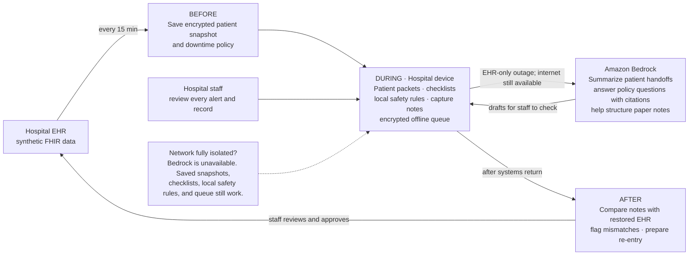

# Downtime Copilot

**The system that works when every other system doesn't.**

When a hospital's EHR goes down—ransomware, CrowdStrike, or a cloud outage—nursing supervisors lose the tools that keep patients safe: barcode med scanning, allergy alerts, shift handoffs, and order history. Downtime Copilot keeps the hospital running by preparing for outages, guiding staff through paper procedures with AI-powered safety checks, and automating recovery when systems return.

## The Persona: Priya Nair

**Nursing supervisor, 24-bed medical-surgical unit. 2:47 AM, ransomware alert. EHR goes dark for 11 hours.**

- 6 nurses, 4 fresh admits, 40+ medications due at 4 AM
- No barcode scanning → every dose is a safety risk without human verification
- No allergy/drug-interaction alerts → medication errors spike
- Day shift arrives at 7 AM with no handoff from night shift
- When the EHR returns, everything written on paper has to be re-entered by exhausted staff, and errors pile up

**The cost:** Medication errors, missed handoffs, delayed recovery, compliance risk. Priya needs a system that keeps meds safe *now*, hands off *clearly*, and recovers *fast*.

---

## What Downtime Copilot Does

Downtime Copilot works in three phases:

### 🔄 BEFORE: Readiness (every day)
- **Encrypted snapshots**: Every 15 minutes, save a timestamped patient packet (allergies, current meds, recent labs, upcoming doses) to a hospital device
- **Downtime drill mode**: AI walks through a simulated outage; hospital gets a readiness score
- **Readiness dashboard**: "ICU tablets last synced 2 hrs ago ⚠️" — catches stale data before crisis

### 🚨 DURING: Response (when systems are down)

**Medication safety** (the critical piece):
- Barcode scanning is gone. Bedrock and local rules check every dose:
  - ⚠️ "Patient allergic to penicillin, amoxicillin requested"
  - ⚠️ "Last heparin dose 2 hrs ago—this would be a double dose"
  - ⏰ "4 patients on 3B have doses due in 30 min"

**Shift handoff**:
- Bedrock generates a shift handoff card from the snapshot + any notes captured during downtime
- Printed or read aloud to the day shift; shows provenance of every fact

**Capture & structure**:
- Photograph a paper form → Bedrock + Textract parses it → nurse verifies → queued for re-entry
- Voice order: "Give 500mg Tylenol" → Bedrock transcribes → reads back for confirmation → logged

**Supervisor command center**: One screen shows all units' status, overdue meds, critical labs waiting to be called in

### 🔁 AFTER: Recovery (when the EHR returns)
- **Re-entry queue**: Every action captured during downtime, structured and sorted by clinical priority (meds first)
- **Conflict detection**: "Paper says 5mg given, order was 2.5mg — review" 
- **Incident report**: Auto-generated timeline for compliance

---

## Outage Modes

| Scenario | What's Down | What Works |
|----------|-------------|-----------|
| **EHR outage** (CrowdStrike, service outage) | EHR only | Snapshots + Bedrock (full cloud AI) |
| **Ransomware / network shutdown** | EHR, network, internet | Snapshots + local rules only (Bedrock unavailable) |

Both cases use the same app. The difference: with internet, you get AI summaries and form parsing. Without internet, you get rule-based med checks, checklists, and a queue to sync later.

---

## Demo Script (5 minutes)

1. **Open a patient packet** (10 sec): Show Priya opening patient "Sarah Chen" — allergies, current meds, last snapshot time
2. **Medication safety in action** (30 sec): A nurse tries to give an order. Bedrock + local rules flag an allergy. Nurse reviews, confirms it's caught.
3. **Shift handoff** (30 sec): Bedrock generates a handoff card from Sarah's snapshot + captured notes. Priya reads it aloud to day shift.
4. **Photograph & parse** (30 sec): Nurse photographs a handwritten paper form. Bedrock structures it; nurse verifies; it enters the queue.
5. **Offline indicator** (10 sec): Toggle network offline. Show med safety checks still work.
6. **Recovery queue** (20 sec): When the EHR comes back, show re-entry queue, sorted by priority, conflict detected and flagged.

---

## Getting Started as a Team

### Prerequisites
- Node.js 18+, npm/yarn
- AWS account (team will receive credentials & Bedrock access at event)
- Kiro account (credits provided for LLM calls)

### Setup
```bash
git clone <this-repo>
cd DowntimeCopilot
npm install
npm run dev
```

Agree on **one app framework** (React, Vue, etc.) **before splitting up**. Keep the first data shapes small:

- **Patient**: `{ id, name, allergies[], medications[], snapshot_time }`
- **Downtime note**: `{ id, patient_id, note_type, content, timestamp, source, review_status }`
- **Med safety check**: local rule engine (no AI needed; runs offline)

### Four-Person Split

| Owner | Focus | First Deliverable |
|-------|-------|-------------------|
| **1. Frontend** | Patient list, med-entry form, policy Q&A screen, handoff card, recovery queue, offline toggle | Clickable app using mock data & stubbed API |
| **2. Backend & data** | API design & implementation, synthetic patient snapshots (Synthea/FHIR), queue storage, local med-safety rule engine | API that returns a patient packet and stores a downtime note |
| **3. Bedrock workflow** | Integrate Bedrock calls for handoff summary, form parsing, voice transcription; handle failures gracefully; require human review | Working Bedrock call that produces a sourced summary; staff reviews and approves |
| **4. AWS & deployment** | Set up Bedrock credentials, Lambda functions, DynamoDB, S3 for snapshots; expose a safe endpoint for person 3 to call | Real Bedrock invocation in the app, visible in demo |

**Day 1 rule:** Agree on API request/response shapes. Use mock Bedrock responses so everyone can work in parallel. Day 2: Replace mocks with real AWS.

---

## Safety Principles

- **AI is a helper, not a decision-maker.** Bedrock suggests; a nurse decides. No automatic EHR writes.
- **Show your sources.** Every fact in a packet or summary says where it came from: snapshot timestamp, which note, which source section.
- **Work offline first.** Medication safety checks use local rules and snapshot data. If Bedrock is unavailable, the app still works.
- **Staff verify everything.** Every Bedrock output (handoff card, parsed form, transcribed order) is reviewed by a human before it's final.
- **Synthetic data only.** Demo uses Synthea-generated FHIR data. Production requires hospital security, privacy, and clinical-safety review.

---

## Success Metrics for the Demo

✅ **Rubric gate 1 (Real person + real need)**: Priya Nair, medication safety during 11-hour outage  
✅ **Rubric gate 2 (Working app)**: End-to-end flow visible—from med check to handoff to recovery queue  
✅ **Rubric gate 3 (Bedrock doing real work)**: Handoff summary, form parsing, or voice transcription actually uses Amazon Bedrock, visible in the demo  
✅ **Rubric gate 4 (You understand it)**: Three-phase model, two failure modes, clear role for AI vs. local rules  
✅ **Polish**: Hospital staff would actually trust and use this

## Architecture



**In one sentence:** We copy essential patient information before an outage, help staff work safely from that copy during the outage, then help them reconcile their notes when the EHR returns.

**What to show in the demo:** Open a patient packet, ask a question answered from the hospital's downtime policy, and show Bedrock producing a sourced draft that a staff member reviews. Then show the offline workflow and the recovery queue. This makes Bedrock's real role visible while showing that essential functions still work without internet.

## Getting started as a team

Build one small end-to-end demo before expanding the feature list:

1. Open a synthetic patient and show their saved allergies, medications, and snapshot time.
2. Ask a question using a sample downtime policy. Amazon Bedrock answers using that policy and shows the relevant section; a staff member reviews the answer.
3. Record a sample downtime note and show it in a queue marked **Needs review**.
4. Show that the patient snapshot and a basic local safety check still work with the network disconnected.

### Suggested split for four people

| Owner | Focus | First deliverable |
| --- | --- | --- |
| **1. Frontend** | Patient list and packet, policy question screen, downtime-note capture, review queue, offline indicator | Clickable app flow using agreed API shapes and mock data |
| **2. Backend** | Shared data model and API; synthetic patient data; snapshot and downtime-note queue; basic local checks and recovery status | API returns a patient packet and accepts a note that remains queued |
| **3. AI agent / workflow** | Turn a staff question into a grounded policy-answer request; present the answer with its source; handle unavailable/failed AI clearly; require staff review | Working policy Q&A workflow using a stubbed AI response first |
| **4. Bedrock and AWS** | AWS setup and credentials; Bedrock invocation and policy grounding; expose a narrow endpoint for the agent workflow to call | Real Bedrock answer with a policy section/source, demonstrated in the app |

**Keep the AI/cloud boundary clear:** Person 4 owns the AWS connection and a small service/API that safely calls Bedrock. Person 3 owns the staff-facing AI workflow that calls that service and handles sources, drafts, and review states. Person 3 should not manage AWS credentials or duplicate the Bedrock integration. Keep clinical safety checks rule-based and local; do not have an agent make care decisions.

Agree together on the app framework, how to run the project, and the API/data shapes before splitting up. Keep the first shared records small:

- **Patient:** ID, synthetic name, allergies, medications, snapshot time.
- **Downtime note:** ID, patient ID, note type, content, timestamp, source, review status.
- **Policy answer:** question, draft answer, policy section/source.

Use mock data and a stubbed AI endpoint at first so everyone can build in parallel. Agree on endpoint request/response examples on day one, connect the pieces early, then replace the stub with a real Amazon Bedrock call. The event rubric requires an AWS AI service to do real work in the application; make the Bedrock feature visible in the demo, not just in the architecture. Do not use real patient data.

### How the outage modes work

| Mode | Available | Deferred until connectivity returns |
| --- | --- | --- |
| **EHR outage; hospital network and internet available** | Local snapshots and checks; policy retrieval; Bedrock summaries/guidance; Textract and Transcribe processing; sync and audit | Nothing, subject to service availability |
| **Ransomware / network isolation** | Cached patient packets and policy; local rule-based safety checks; checklists; local form/order capture; encrypted action queue; handoffs | Cloud AI, cloud OCR/transcription, remote audit sync, and EHR reconciliation |

### Safety and trust boundaries

- Patient facts in packets and summaries come from a timestamped snapshot or staff-confirmed downtime records; show provenance with each fact.
- Medication checks use explicit local rules and snapshot data. They support—not replace—clinical judgment and institutional medication procedures.
- AI output is a draft. A staff member reviews and confirms it; EHR re-entry is never automatic.
- Keep the app useful without AI or internet. If cloud processing is unavailable, captured items remain queued for later review.
- Encrypt device data and queued actions; restrict access by role; audit views, edits, confirmations, and sync.
- Use synthetic patient data only in the demo. Production deployment requires hospital security, privacy, clinical-safety, and integration review.