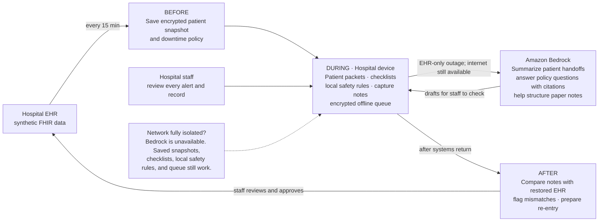

# Downtime Copilot

**The system that works when every other system doesn't.**

An offline-first companion for hospital staff before, during, and after an EHR outage. It prepares patient-specific downtime packets, guides staff through approved paper procedures, and helps reconcile verified records when systems return.

> **Demo safety:** use synthetic Synthea/FHIR data only. The assistant never makes a clinical decision or writes to the EHR on its own. Staff verify every captured or suggested action.

## Architecture

**In one sentence:** We copy essential patient information before an outage, help staff work safely from that copy during the outage, then help them reconcile their notes when the EHR returns.

**What to show in the demo:** Open a patient packet, ask a question answered from the hospital's downtime policy, and show Bedrock producing a sourced draft that a staff member reviews. Then show the offline workflow and the recovery queue. This makes Bedrock's real role visible while showing that essential functions still work without internet.

## Getting started as a team

Build one small end-to-end demo before expanding the feature list:

1. Open a synthetic patient and show their saved allergies, medications, and snapshot time.
2. Ask a question using a sample downtime policy. Amazon Bedrock answers using that policy and shows the relevant section; a staff member reviews the answer.
3. Record a sample downtime note and show it in a queue marked **Needs review**.
4. Show that the patient snapshot and a basic local safety check still work with the network disconnected.

### Suggested split for four people

| Owner | Focus | First deliverable |
| --- | --- | --- |
| **1. App and experience** | Main screens and navigation: patient list, patient details, policy question, review queue | Clickable app flow using sample data |
| **2. Patient data and offline behavior** | Synthetic patient records, saved snapshot, offline access, basic rule-based warning | Patient details and warning available without network |
| **3. Bedrock feature** | Policy question-answering grounded in sample policy; return answer and section citation | Working Bedrock response shown in the app, with staff review |
| **4. Capture and integration** | Capture a sample downtime note, connect the components, show review status and demo flow | End-to-end flow from patient selection to queued note |

Agree together on the app framework, how to run the project, and the data shapes before splitting up. Keep the first shared records small:

- **Patient:** ID, synthetic name, allergies, medications, snapshot time.
- **Downtime note:** ID, patient ID, note type, content, timestamp, source, review status.
- **Policy answer:** question, draft answer, policy section/source.

Use mock data at first so everyone can build in parallel. Integrate early, then replace the mock Bedrock response with a real Amazon Bedrock call. The event rubric requires an AWS AI service to do real work in the application; make the Bedrock feature visible in the demo, not just in the architecture. Do not use real patient data.

### How the outage modes work

| Mode | Available | Deferred until connectivity returns |
| --- | --- | --- |
| **EHR outage; hospital network and internet available** | Local snapshots and checks; policy retrieval; Bedrock summaries/guidance; Textract and Transcribe processing; sync and audit | Nothing, subject to service availability |
| **Ransomware / network isolation** | Cached patient packets and policy; local rule-based safety checks; checklists; local form/order capture; encrypted action queue; handoffs | Cloud AI, cloud OCR/transcription, remote audit sync, and EHR reconciliation |

### Safety and trust boundaries

- Patient facts in packets and summaries come from a timestamped snapshot or staff-confirmed downtime records; show provenance with each fact.
- Medication checks use explicit local rules and snapshot data. They support—not replace—clinical judgment and institutional medication procedures.
- AI output is a draft. A staff member reviews and confirms it; EHR re-entry is never automatic.
- Keep the app useful without AI or internet. If cloud processing is unavailable, captured items remain queued for later review.
- Encrypt device data and queued actions; restrict access by role; audit views, edits, confirmations, and sync.
- Use synthetic patient data only in the demo. Production deployment requires hospital security, privacy, clinical-safety, and integration review.