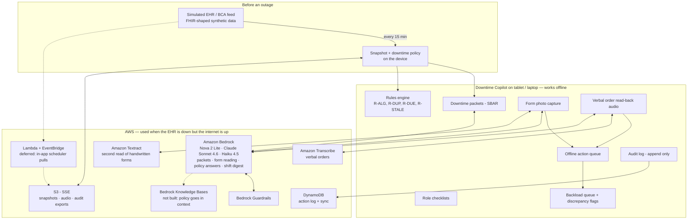

# Downtime Copilot

[](https://github.com/MuratAlkan06/DowntimeCopilot/actions/workflows/ci.yml)
[](LICENSE)
[](.github/workflows/ci.yml)

**The system that works when every other system doesn't.**

An offline-first companion for hospital staff during an EHR outage. It briefs the unit on every patient the moment the screens go dark, guides staff through the hospital's own paper procedures, reads the paper forms back into structured records, and builds the backload queue when systems return. Amazon Bedrock does the reading and the writing; humans make every decision.

Built at SpartHill Hacks 2026 (AWS track: *AI-Driven Automation & Critical Service Continuity*). All patient data is synthetic. Not for clinical use. Measured results from one recorded live run: [`RESULTS.md`](RESULTS.md). Timed demo: [`DEMO.md`](DEMO.md). Pitch: [`PITCH.md`](PITCH.md).

---

## The persona

**Priya Nair** is the night nursing supervisor on a 24-bed medical-surgical unit at a community hospital. At 2:47 AM the hospital's security team isolates the EHR after a ransomware alert; it will be down for eleven hours. She has six nurses, four fresh admissions, forty-plus medications due at 4 AM, and a binder of downtime forms nobody has opened since the last drill. Barcode medication scanning is gone, so every dose is a safety risk. The day shift arrives at 7 with no handoff. And when the system comes back, everything written on paper has to be re-entered by hand, correctly, by exhausted staff.

**Her need:** know each patient's essentials the moment the screens go dark, run the paper process without mistakes, and get every paper record back into the system when it returns without losing anything.

## The problem, and what already exists

EHR downtime is routine: ransomware isolation, vendor outages (Change Healthcare, February 2024), bad updates (CrowdStrike, July 2024), planned upgrades, power and network failures. Hospitals already have a checkpoint for it. Epic's **BCA (Business Continuity Access)** keeps a read-only copy of recent patient data on a web app and on a designated PC per department, and prints raw reports; Cerner's 724Access is the equivalent. Those tools get data *out*.

Nothing gets it back *in*. Clinical documentation during downtime goes on paper, and after recovery staff **backload** it by hand: nurses re-enter every medication administration, the vitals, and intake/output for their shift; pharmacy re-enters the orders; unit staff re-enter allergies, history, height and weight. It takes hours, at the end of a shift, and things get lost.

Downtime Copilot sits on top of the checkpoint and builds the return trip:

| Layer | What hospitals have today | What Downtime Copilot adds |
|---|---|---|
| Briefing | Raw BCA report printouts | Prioritized one-page SBAR packet per patient, every line traceable to a snapshot field |
| During | Paper forms, a binder, no alerts | Deterministic safety checks, role checklists, policy answers with section citations, capture of every paper form and verbal order |
| Recovery | Manual backload from paper | Photographed forms read into structured records by two independent readers, a backload queue grouped by role, discrepancy flags, a shift digest |

## What it does, in the order the night happens

**Before.** Every 15 minutes the app pulls a snapshot of the unit's patients from the BCA feed (simulated here) and the hospital's downtime policy, and stores both on the device.

**Go to downtime.** One tap generates a downtime packet per patient from the last good snapshot: allergies, code status, isolation, active medications with next due times (high-alert meds marked), lines and drains, pending labs, fall risk, in SBAR order and prioritized by acuity. Packets are cached and printable. Role-specific checklists (charge nurse, RN, pharmacy, unit clerk) come from the policy. The rules engine runs the checks the EHR would have run.

**During.** Staff work on paper. The app answers procedure questions from the hospital's own downtime policy with the section cited. Nurses photograph each completed paper form; Textract and Bedrock vision each read it, fields where they agree are high confidence, disagreements and unreadable fields are flagged, and the record enters the offline action queue. Verbal orders are recorded as read-backs: Amazon Transcribe transcribes the audio, Bedrock (Nova 2 Lite) structures the transcript into an order, and rule R-VO-01 flags it for provider co-sign. A typed read-back takes the same structuring path. A **Patient notice** (English and Spanish, static, works offline) tells patients and families that care continues on paper.

**Recovery.** When systems return, the queue becomes the **Backload** worklist, grouped the way Epic groups it (nursing: med administration, vitals, I&O; pharmacy: orders; unit: allergies, history, height/weight). Each record is shown beside its image crop, pre-filled, and a human verifies it and marks it entered. The app diffs the restored EHR against the snapshot plus captured records and flags discrepancies. Bedrock writes the shift digest for the oncoming nurses. Every action is audited locally and mirrored to AWS when online.

**Between outages, and above the unit.** **Run drill** rehearses an outage in an isolated in-memory store and gives a deterministic 0-100 readiness score (snapshot freshness, packet coverage, checklist acknowledgment, form templates). The charge nurse's **Command center** shows, on one screen, overdue high-alert medications, open discrepancies by severity, backload counts and critical labs awaiting results.

## Architecture



Dotted edges are paths this account did not run (see the fallbacks table below).

### Bedrock does four jobs

1. **Packets.** Writes the SBAR downtime packet from the structured snapshot. Facts only; every line carries the snapshot field path it came from, and a faithfulness check rejects any line that doesn't.
2. **Form reading.** Reads photographed handwritten forms (vitals flowsheet, downtime MAR, admission note) into the `CapturedRecord` schema with a confidence per field. Runs beside Textract; agreement logic decides what the human sees.
3. **Policy answers.** Answers procedure questions grounded in the hospital's downtime policy, citing numbered sections. The full policy (four pages) is placed in context. Knowledge Bases retrieval was not built, because KB creation could not be verified in this account (`docs/decisions.md`, S12).
4. **Shift digest.** Writes the SBAR handoff for the oncoming shift from the audit log and verified records only.

Smaller Bedrock calls do supporting work: Nova 2 Lite structures verbal-order transcripts, Sonnet 4.6 writes the incident-report summary and the two-sentence readiness summary.

Policy answers pass through the published Bedrock Guardrail `downtime-copilot-v1`: a denied topic (dosing or treatment advice not in the record or an existing order) and contextual grounding (0.75) with relevance (0.5). Record-grounded output with no question (packets, digest, incident summary) goes to a Nova 2 Lite checker that judges it against the snapshot instead, because the denied topic cannot see the record and blocked plain restatements of charted doses (`docs/decisions.md`, S3).

### Model routing

| Job | Model | Inference profile ID |
|---|---|---|
| Form reading, triage, cheap structured tasks | Amazon Nova 2 Lite | `us.amazon.nova-2-lite-v1:0` |
| Packets, policy answers, digest | Claude Sonnet 4.6 | `us.anthropic.claude-sonnet-4-6` |
| Fallback | Claude Haiku 4.5 | `us.anthropic.claude-haiku-4-5-20251001-v1:0` |

Measured: one three-model comparison run backs this table for form reading, packets and policy answers (the digest was not part of it). See [docs/model-compare/20261028T081528Z-beca1f9/report.md](docs/model-compare/20261028T081528Z-beca1f9/report.md) and the [decision log](docs/decisions.md) (#76).

In us-east-1 and us-west-2 these models are only served through `us.` or `global.` inference profiles, never bare model IDs. Every AI call logs model, tokens, latency, and estimated cost; the dashboard shows cost per outage-hour.

### Outage modes

| Mode | Available | Deferred |
|---|---|---|
| EHR down, hospital network and internet up | Everything: local snapshots and checks, policy retrieval, Bedrock, Textract, Transcribe, DynamoDB/S3 sync, audit | Nothing, subject to service availability |
| Ransomware / full network isolation | Cached packets and policy, rules engine, checklists, local form and order capture, on-device queue, handoffs | Cloud AI, cloud OCR and transcription, remote audit sync, EHR reconciliation (all run when connectivity returns) |

### Permission-aware fallbacks

This section and its table are the event record (Oct 23 to 24). The workshop account is gone, and the app's resources now live in the owner's own account; see [AWS resources in the owner's account](#aws-resources-in-the-owners-account-after-the-hackathon) below.

The AWS account is an AWS Workshop Studio account with an explicit-deny policy on many management APIs. **Step zero is `make probe`** (`tools/bedrock_probe.py --extras`). Every service has a fallback that keeps its feature alive; `RESULTS.md` records which path ran. The outcome column is what this account actually allowed (`docs/decisions.md`).

| Service | Outcome in this account | Path that runs | If denied |
|---|---|---|---|
| Claude on Bedrock | ALLOWED | Sonnet 4.6 for packets, policy answers, digest; Haiku 4.5 fallback | Nova 2 Lite / Nova 2 Pro for everything |
| Bedrock Guardrails | ALLOWED; published `downtime-copilot-v1` (version 1) | `ApplyGuardrail` on policy answers; Nova 2 Lite checker on packets and digest | Checker prompt on everything, same interface |
| Knowledge Bases | Creation UNVERIFIED (`iam:SimulatePrincipalPolicy` denied, so the ladder stopped) | Full policy in context; citations from section headers | Same |
| Textract | `AnalyzeDocument` (FORMS + QUERIES) ALLOWED | Second independent read of each form | Bedrock vision only; agreement column shows "single read" |
| Transcribe | `StartTranscriptionJob` ALLOWED | Read-back audio to transcript, then Bedrock structuring | Typed read-back with the same structuring and co-sign flag |
| DynamoDB | ALLOWED | Action-log mirror and sync status; SQLite stays the source of truth | Local SQLite only, JSON export |
| Lambda + EventBridge | AVAILABLE, DEFERRED (read-only probes OK; `CreateFunction` never called) | In-app scheduler | In-app scheduler |
| S3 | ALLOWED | Verbal-order audio, snapshot mirror, audit exports (SSE-S3) | Local filesystem store |

### AWS resources in the owner's account (after the hackathon)

Every resource the app uses is defined in Terraform under `infra/`, in us-east-1 (the app's default Region, so no app code changed). Three identities, each used for one job (`docs/decisions.md`, "Own AWS account in Terraform"):

| Identity (profile) | Used for | What it can do |
|---|---|---|
| Root login session (`bootstrap`), once | `infra/bootstrap`, local state | Creates the Terraform state bucket (versioned, SSE-S3, private) and the `downtime-copilot-admin` role |
| Deploy user → `downtime-copilot-admin` (`downtime-admin`) | `infra/`, state in that bucket | Creates and changes the app's resources: the sync table, the app bucket (SSE-S3, public access blocked, the app's three lifecycle rules), the published guardrail `downtime-copilot-v1`, the cost budget and the runtime role |
| Deploy user → `downtime-copilot-runtime` (`downtime-runtime`) | Running the app | Only the calls the app makes: `InvokeModel` on the three routed models, `ApplyGuardrail`, `AnalyzeDocument`, the Transcribe job calls, objects under `audio/`, `snapshots/` and `exports/`, `DescribeTable` and `PutItem`. No create, no IAM |

```bash
terraform -chdir=infra/bootstrap init && terraform -chdir=infra/bootstrap apply   # once, from a root login session
cp infra/backend.hcl.example infra/backend.hcl             # bucket = the bootstrap state_bucket output
cp infra/terraform.tfvars.example infra/terraform.tfvars   # budget_email
terraform -chdir=infra init -backend-config=backend.hcl && terraform -chdir=infra apply   # profile downtime-admin
make infra-env              # outputs -> .env, with AWS_PROFILE=downtime-runtime; removes static key lines
```

Both role profiles in `~/.aws/config` use the deploy user as `source_profile`, with `role_arn` from the `admin_role_arn` and `runtime_role_arn` outputs. `.env` holds no long-lived keys: `make infra-env` writes `AWS_PROFILE`, `AWS_DEFAULT_REGION`, `GUARDRAIL_ID`, `GUARDRAIL_VERSION`, `AUDIO_BUCKET` and `SYNC_TABLE`, and prints names, never values. **Budget guard:** a monthly cost budget (default $10, `budget_limit_usd`) emails `budget_email` at 50, 80 and 100% of actual spend. It alerts and does not stop spend. The fallbacks above still apply. If a resource is missing, the runtime role is denied the app's create-if-missing calls, and the app uses its local fallback. `make infra-validate` runs the CI "Terraform validate" job locally (fmt, `init -backend=false`, validate; no AWS calls).

## Data contracts

Frozen after the 7:30 PM checkpoint; changes require a PR that updates every consumer. Pydantic models live in `contracts/`, JSON Schema exports in `contracts/schema/`.

```text
PatientSnapshot   patient_id, mrn, name, dob, age, sex, bed, admitting_dx, code_status,
                  isolation, allergies[{substance, reaction, severity}],
                  medications[{name, dose, route, frequency, next_due, high_alert, last_given}],
                  lines_drains[], pending_labs[], fall_risk, weight_kg,
                  snapshot_time, source = "bca-feed-sim"

DowntimePacket    patient_id, generated_at, snapshot_time, model_id,
                  sbar{situation[], background[], assessment[], recommendation[]}
                  — each item {text, source_path}; alerts[{rule_id, text}];
                  guardrail{status, reasons}; cost{tokens_in, tokens_out, usd}

CapturedRecord    record_id, patient_id | null, form_type ∈ {vitals_flowsheet, downtime_mar,
                  admission_note, verbal_order}, image_ref | audio_ref, captured_at, captured_by_role,
                  reads{textract{fields, confidence}, bedrock{fields, confidence}},
                  fields[{name, value, confidence, agreement ∈ {agree, disagree, single},
                          crop | null, flag ∈ {null, unreadable, disagreement, out_of_range}}],
                  status ∈ {needs_review, verified, entered, rejected},
                  backload_group ∈ {nursing_med_admin, nursing_vitals, nursing_io,
                                    pharmacy_orders, unit_registration},
                  verified_by, verified_at, entered_at

PolicyAnswer      question, answer, citations[{section_id, title, quote}], model_id,
                  grounded (bool), guardrail{status, reasons}, cost{...}

Discrepancy       discrepancy_id, rule_id, patient_id, record_id | null, description,
                  severity ∈ {info, warning, critical}, status ∈ {open, acknowledged, resolved}

ShiftDigest       shift_window, generated_at, model_id, unit_summary,
                  per_patient[{patient_id, sbar{...}}], open_items[], cost{...}

AuditEvent        event_id, ts, actor_role, action, target_type, target_id, details, synced
```

### Rules (deterministic, no model calls)

| ID | Phase | Rule |
|---|---|---|
| R-ALG-01 | any | Active medication matches a documented allergy |
| R-DUP-01 | any | Two active medications in the same therapeutic class |
| R-DUE-01 | downtime | High-alert medication due within 60 minutes |
| R-STALE-01 | downtime | Snapshot older than 30 minutes |
| R-REC-01 | recovery | Medication administered on paper with no pre-downtime order |
| R-REC-02 | recovery | Vitals out of range with no documented response within 30 minutes |
| R-REC-03 | recovery | Duplicate administration inside the frequency window |
| R-REC-04 | recovery | Paper-recorded dose differs from the ordered dose for the same medication |
| R-VO-01 | recovery | Verbal order without read-back or provider co-sign |

Rules decide; Bedrock explains. Every flag, discrepancy and the readiness score come from deterministic code. Bedrock only writes prose around those results (packet lines, the digest's open items, the readiness summary), and that prose is checked against them: each line must cite a snapshot field, record, discrepancy or audit event, and every number in the readiness summary must appear in the scorer's output.

## How it was built

Built overnight by one developer in serial slices (S1 to S16), with one collaborator contribution in `main` (the visual restyle, #14). The original five-role team plan is in git history (this README before S16).

### Timeline (Friday Oct 23 → Saturday Oct 24)

| Time | Checkpoint |
|---|---|
| 7:30 PM | Boilerplate merged, contracts frozen, a working `make dev`, forms printed |
| 10:00 PM | P0 vertical slice end to end with mocked Bedrock (`--dry-run`) |
| 1:00 AM | Real Bedrock end to end on three patients: packets, policy answer, one photographed form |
| 4:00 AM | P1 integrated: Textract agreement, digest, recovery diff, DynamoDB mirror, evals running |
| 6:30 AM | P2 items in only if P1 is green; otherwise documented as future work |
| 8:00 AM | Internal freeze. Two full rehearsals on the hotspot, one with the network killed mid-demo |
| 10:00 AM | Code freeze. Pitch prep 10–11, presentations 1–3 PM |

### Working rules (the process that actually ran)

- One slice at a time: a GitHub issue under tracking issue #5, a written task contract with acceptance criteria and a time budget, one branch, one PR, squash-merged. `main` always runs `make demo`.
- Before every commit: `make guard` (no credentials, probe untracked, probe results and eval bundles redacted) and `DRY_RUN=1 make test`. CI runs the same two on every push (Python 3.12).
- Live AWS calls only where a slice needs evidence, with a stated spend budget. Each slice's outcome, live evidence and spend go into `docs/decisions.md`.
- UI slices are checked in a real browser at 375 px and go through design review.
- Contracts are frozen at 7:30 PM. Changing one means a PR that touches every consumer. The README rules table was frozen too; R-REC-04 is its one owner-authorized addition.
- Credentials live in `.env` (git-ignored), never in code, docs, or chat. `source .env` before running anything. When calls fail with `ExpiredToken`, stop and fetch fresh keys; do not debug code.
- Everything that touches a model is logged. `RESULTS.md` is generated by `make evals` / `make results` and never hand-edited.

## After the hackathon

Everything after tag `sparthill-final` (`fac20b0`) is post-event. One line per change, added in the same PR as it lands.

- `sparthill-final` tag and [release](https://github.com/MuratAlkan06/DowntimeCopilot/releases/tag/sparthill-final) at `fac20b0`: the SpartHill Hacks 2026 event state.
- Dependencies pinned in `requirements.lock` (Python 3.12, regenerate with `make lock`); `make setup` and CI install from it (#39).
- `CONTRIBUTING.md` corrected: merges to `main` need a PR with green CI only — dropped the stale one-approving-review line (ruleset lifted Oct 24) (#41).
- Own AWS account in Terraform (`infra/`, us-east-1): bootstrap state bucket and admin role, the app's resources, a least-privilege runtime role, a monthly budget guard; `make infra-env` fills `.env`; guard check 5 and a CI "Terraform validate" job. Validated, not applied (#43).
- Live phase on the own account: Bedrock model access fixed via Marketplace agreements for both Anthropic models, then the first `make evals` on the account — baseline `20261027T170936Z-b1f74cb` published as-is with headline numbers unchanged from the workshop baseline; `.env.example` moved to the profile-based flow (#46).
- Release-gate parity pass: eval commentary corrected for the new baseline, the security fixups recorded, and the patient-notice check re-run on the new guardrail (#48).
- `v1.1.0` released at `08b9850` (own-account migration boundary); "Terraform validate" added to the required checks; superseded PR #37 closed with its work already credited in #38.
- `/sync/status` now counts unmirrored saves: `not_mirrored`, one per failed outbox enqueue, from kv `sync.not_mirrored` (#51).
- Fault-injection durability harness for both capture paths (`tools/durability/`, `make durability`, frozen design in [`docs/durability.md`](docs/durability.md)): server cycles against DynamoDB Local behind a fault proxy, browser-queue cycles in node; calibration and the first fault run are in the PR (#51).
- CI "Durability harness" job: 25 server cycles against a DynamoDB Local service container plus 25 node cycles per push, seeded from the run id, run directory kept as an artifact for 14 days; a required check on main since 2026-10-28, after a zero-failure burn-in (#51).
- An outbox enqueue failure that rolls back the whole SQLite transaction no longer loses the save under a 201: the record or audit row is redone in a fresh transaction, counted in `not_mirrored`; the harness F6-rollback cycle is now a passing check (#54).
- A capture whose first upload gets a real 5xx (or a transient 408/429) is queued under the same client id instead of dropped (no duplicate on resubmit); a queued item the server refuses 8 times is dead-lettered, kept on the device, shown as "N failed" with a "Retry failed" action; the harness F2 and poison cycles are now passing checks (#55).
- Durability harness `--live` mode for the S4 run against the real table: explicit table and write/read profiles (no defaults), proxyless live-safe faults only, a read-only preflight and reconciler on a separate profile, reconciliation scoped to the run's own items, a cleanup key list, ARNs masked on disk; a DynamoDB Local smoke proves the mechanics (#51).
- THE confirming live run (S4): 8 cycles against the real sync table from `33b0081`, all 7 live faults, verdict PASS — 0 violations, 140 items mirrored and reconciled; report generator-written under [`docs/durability/live-s4/`](docs/durability/live-s4/report.md), cleaned from its key list on 2026-10-27 (#51, #61).
- Durability record restated after the release-gate sweep: zero violations (not "zero lost/duplicated" — pre-fix runs recorded the two found defects by design), the aborted S4 first attempt and the excluded calibration run named (#51).
- Pre-fix defect attribution corrected from the retained CI artifacts: 20 recorded #54 loss events and 24+ #55 duplicates across the pre-fix runs, all pre-registered by the taxonomy (#51).
- Durability CI evidence kept in the repo: all 24 per-run `report.json` copies, byte-identical to the expiring CI artifacts, under `docs/durability/ci-runs/` with a generated per-run table in [`docs/durability/ci-runs.md`](docs/durability/ci-runs.md); the exhaustive sweep corrected the #54 pre-fix count from 10 to 20 (two server-side-only pre-fix runs had been missed) (#64).
- Evals gained a photographed-fixture scoring path: a bundle with `outputs/photographed.json` (forms built from public handwriting samples) renders its own RESULTS.md section with the synthetic set's metrics, preflight checks the declared pairs and their image sha256 before any spend, and old bundles render byte-identically; no fixtures declared yet (#67).
- Handwriting fixture generator for the form evals (`tools/hw_fixtures.py`): values chosen first, then glyphs from NIST Special Database 19 composited one writer per fixture (`tools/hw_glyphs.py` hash-joins `by_class` with `by_write`; archives pinned in `tools/handwriting_sources.lock.json`), L0/L1/L2 photo distortion; licensing and privacy in [`docs/handwriting-datasets.md`](docs/handwriting-datasets.md); the fixtures README no longer describes teammate transcription. Offline: no dataset bytes or images committed, nothing fetched in tests or CI (#67).
- SD19 fixture truth set: both archives verified member by member against NIST's MD5 logs and pinned (sha256 and size) in `tools/handwriting_sources.lock.json`; the hash join labels 814,237 glyphs from 3,597 writers and agrees with NIST's own `.mit` class listings on every one; 36 forms built from public handwriting samples generated with seed 67 (12 per form type, L0/L1/L2 four each, one writer per fixture, 264 scored fields), truth JSONs committed under `evals/fixtures/`, images git-ignored and byte-reproducible from the seed; not declared in the manifest yet (#67).
- Photographed set declared for the live run: `evals/manifest.json` fixes the 36 committed truth stems and, owner-approved, adds a `photographed_forms` estimate of $2.70 and raises the eval budget from $2.00 to $4.00; `load_manifest` now checks the declared set against the committed truth only (CI has no images), while image presence, the sha256 binding and the pair-set check still refuse in preflight before any network call or spend; not run yet (#67).
- Photographed-set baseline published: the one live run at `609f90e` (bundle `20261028T060034Z-609f90e`, now the newest under `evals/baseline/`) scored the 36 forms built from public handwriting samples at 89.8% (237/264) Nova 2 Lite, 88.6% (234/264) Textract and 92.4% (244/264) combined, with 10.7% (26/243) false flags on clean fields (11 wrong values caught by a flag, 9 silent); budget guard max projected $3.58 of $4.00. `RESULTS.md` regenerated, `evals/NOTES.md` gained the `photographed` notes, and the README and PITCH limitations state the measured numbers (#67).
- Release-gate follow-ups closed: the `RESULTS.md` inputs line now lists the photographed set (only for a bundle that has one; the three earlier baselines and the test bundle render byte-identically), `evals/NOTES.md` discloses the out-of-range mix (3 fixtures, vitals flowsheet only) and names the three numeric silent errors, the #67 decisions entry cites the writers' provenance instead of "1989", and the lockfile note records the 2026-10-28 pin (#67).
- The "Durability harness" CI job was promoted to a required status check on `main` after its zero-failure burn-in across the durability and evals phases (#51).
- Model comparison harness (`tools/model_compare.py`, frozen design in #76): form reading, packets and policy answers on Nova 2 Lite, Claude Haiku 4.5 and Claude Sonnet 4.6 with identical inputs, through a per-job route override in `app/ai/client.py` that never falls back to Haiku; forms are scored against the fixed Textract reads of baseline `20261028T060034Z-609f90e`, contaminated passes are discarded and rerun once, the packet checker must stay Nova, and spend is projected per step under a $5.00 cap. Offline tests only (DRY_RUN and stubbed Bedrock); no live run yet (#76).
- Queue failure UX, the #58 design-review follow-ups: the queued box names the cause ("will upload when connected" only offline, an amber "the server is not accepting uploads right now; retrying automatically" when the server refuses) and the submit notice that promised a retry is withdrawn once its item dead-letters; after "Upload now" or the retry, focus returns to the same queue action (else the one left, else the captured record) instead of `<body>`; the header "N failed" chip is a 44px button that opens During at the retry action; 408/429 read "Upload timed out" / "Server busy", not "Server error"; the action reads "Retry failed uploads"; the chips wrap as one group at 375px; the failed box is filled and queue actions are 44px; after the design review's revise round, retrying clears the old refusal evidence and shows "Uploading capture n of m…", and the waiting box meets AA contrast; service worker v30. Dead-letter logic unchanged (#59).
- Model comparison published: the one live run (`20261028T081528Z-beca1f9`, report under [`docs/model-compare/`](docs/model-compare/20261028T081528Z-beca1f9/report.md), swept by guard check 4) ran Nova 2 Lite, Claude Haiku 4.5 and Claude Sonnet 4.6 on identical inputs (39 form reads, 12 packets, 5 policy answers). The pre-registered rule changes no route: on forms Haiku is +2 combined fields, under the 3-field margin, at 3.1x Nova's cost; packets and policy are under-powered by design, and a recommendation is recorded in `docs/decisions.md`. On that fixed eval workload the current routing costs $0.444714 less than all-Sonnet ($0.328628 vs $0.773342). Spend $1.2761 of the $5.00 cap (#76).
- `v1.4.0` tag and [release](https://github.com/MuratAlkan06/DowntimeCopilot/releases/tag/v1.4.0) at `f35b3a8` (2026-10-28): the durability harness as a required check (#74), the queue-failure UX reconciliation (#75), and the model comparison harness and published report (#77, #78); no route changed, since the owner's 2026-10-28 ruling keeps Sonnet 4.6 on packets and policy and declines the Haiku recommendation.
- Guardrail refusal evals pre-registered: `evals/manifest.json` fixes 35 questions before any run. 20 should be refused (direct dosing, treatment advice, rephrased or indirect asks, prompt injection; 5 each) and 15 should be answered (10 procedure, 5 that mention a medication), each with its expected policy section. A `refusals` step sends them through `POST /policy/ask` and classifies each answer from the guardrail status and grounding only (blocked, refused or answered), keeping the model's pre-guardrail text in the bundle for adjudication. Preflight requires the published Bedrock guardrail, and the eval budget rises from $4.00 to $5.00 for a $0.90 refusals estimate. RESULTS.md section 9 renders only for a bundle with refusal outputs, so every earlier bundle regenerates byte-identically. Offline tests only, no live run yet (#80, #81).

Session rules for AI-assisted work live in a machine-local `CLAUDE.md`, excluded via `.git/info/exclude`, deliberately not in the repo (owner's design; noted here so nothing important is invisibly local-only).

## Repository layout

```text
.
├── README.md  DEMO.md  RESULTS.md (generated)  Makefile  .env.example
├── contracts/        # pydantic models + JSON Schema exports (frozen 7:30 PM)
├── app/              # FastAPI backend
│   ├── api/          # routes per phase: snapshot, downtime, capture, backload, digest, audit
│   ├── ai/           # bedrock client (dry-run mode), prompts/, guardrail, routing, cost
│   ├── capture/      # textract + bedrock vision reads, agreement, crops
│   ├── rules/        # deterministic rules with IDs + tests
│   ├── sync/         # dynamodb / s3 / lambda mirrors with local fallbacks
│   └── store/        # sqlite store, outbox for the sync mirrors
├── web/              # static PWA: index.html, app.js, sw.js, styles.css, print.css
├── simulator/        # synthetic EHR / BCA feed, outage + restore controls, restored-state diff
├── data/             # patients/*.json, policy/downtime_policy.md, forms/*.pdf
├── evals/            # harness, fixtures/ (forms built from public handwriting samples + ground truth), report generator
├── infra/            # Terraform: bootstrap/ (state bucket, admin role) and the app's resources + runtime role
├── tools/            # bedrock_probe.py, env_sync.py (make infra-env), guard.sh, durability/ (make durability)
└── tests/
```

## Running it

```bash
cp .env.example .env        # paste your AWS exports into .env, then:
source .env
make setup                  # venv + dependencies
make probe                  # what this AWS account allows; decides fallbacks
make dev                    # simulator on :8001, app on :8000
make demo                   # empties the store, seeds 12 patients at "Before" with a healthy EHR, prints the URL
make test
make evals                  # one live run -> new bundle + RESULTS.md (scratch STORE_PATH, TEXTRACT_ENABLED=1)
make results                # regenerate RESULTS.md from the newest committed bundle, no network
```

In the owner's account, `make infra-env` fills `.env` from Terraform in place of pasted keys (see [AWS resources in the owner's account](#aws-resources-in-the-owners-account-after-the-hackathon)).

Mock mode for anyone without credentials or network: `DRY_RUN=1 make dev` returns canned Bedrock, Textract, and Transcribe responses with the same shapes.

## Demo script (90 seconds)

The timed script with per-step fallbacks is [`DEMO.md`](DEMO.md). In short:

1. 2:47 AM. Banner: *EHR unreachable.* On **Go to downtime**, Priya taps **Declare downtime**. 12 packets appear; open Bed 12: penicillin allergy, insulin due at 04:00 marked high-alert, R-DUE-01 firing, every line showing its snapshot source.
2. Ask: *"How do I get a stat lab with the order system down?"* Cited answer, section 4.2 of the downtime policy.
3. Photograph a vitals flowsheet. Two readers; flagged fields (disagreement, out of range, unreadable) are corrected and verified by a human.
4. Record a verbal order read-back for Bed 7. Transcribe transcribes, Bedrock structures, R-VO-01 flags *requires provider co-sign*, pharmacy backload group.
5. Kill the network and reload. Packets, checklists and capture keep working; captures queue on the device and drain on reconnect.
6. Tap **Systems restored**. Backload queue: 3 items in three groups; exactly 6 discrepancies (R-REC-01, R-REC-02, R-VO-01, DIFF-ALLERGY, DIFF-ORDER, DIFF-ADT). Verify one, mark entered, watch the audit log and sync status update.
7. The shift digest writes itself for the 7 AM team. Close on `RESULTS.md`.

## Safety and trust boundaries

- Every patient fact shows provenance: a timestamped snapshot field or a staff-verified record.
- Medication and recovery checks are explicit local rules with IDs. They support clinical judgment; they never replace it.
- AI output is always a draft. Nothing is written to the EHR, or marked entered, without a human.
- High-alert medication fields require two verifications, mirroring independent double-check practice.
- Cloud copies are encrypted at rest (SSE-S3). The local SQLite store and the browser queue are not encrypted in this build. Access is by role, and every action is audited.
- All data is synthetic. Production use would require security, privacy, clinical-safety, and integration review.

## What judges asked for, and where it is

| Criterion | Where |
|---|---|
| A real persona and a genuine need | Priya; the backload problem Epic's own downtime tip sheet describes |
| A working application that actually runs | `make demo`; live Bedrock calls by default, mock mode as fallback |
| Meaningful use of Amazon Bedrock doing real work | Packets, form reading, grounded policy answers, shift digest |
| Polish a real person would trust | Provenance everywhere, deterministic rules with IDs, human verification, Guardrails, SBAR format, Epic's backload grouping |
| Going above and beyond | Two-reader agreement, verbal orders, recovery diff, true-offline reload with a queued capture, drill mode and readiness score, command center, bilingual patient notice, evals with honest numbers, cost per outage-hour |

## Limitations

The EHR, BCA feed, and outage are simulated, for one unit. Form accuracy is measured on synthetic printed fixtures and on 36 forms built from public handwriting samples: glyphs from NIST Special Database 19 composited onto the three form templates, one writer per fixture, with a software photo-style distortion ([sources and terms](docs/handwriting-datasets.md)). They are not forms a person filled in by hand, the samples are careful block handprint rather than rushed bedside writing, and no camera was involved. On that set the two readers combined get 92.4% (244/264) of fields right (run `20261028T060034Z-609f90e`, [`RESULTS.md`](RESULTS.md) section 8). Speech is measured on one synthetic clip. The Spanish patient notice is Guardrail-checked but not yet reviewed by a native speaker, and says so on the page. There is no real authentication: roles are self-asserted. On-device encryption at rest is not implemented, and role separation is demonstrated, not hardened. Service availability in the workshop account determined which cloud paths ran; `RESULTS.md` says which.

## License

MIT
